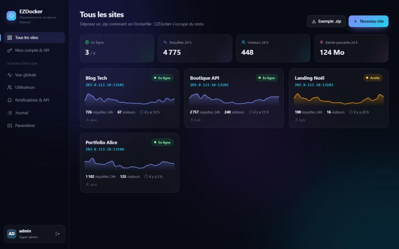
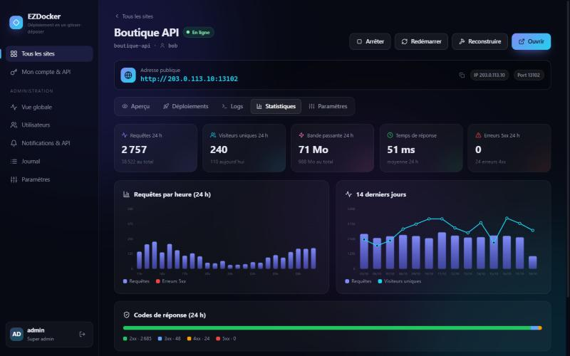
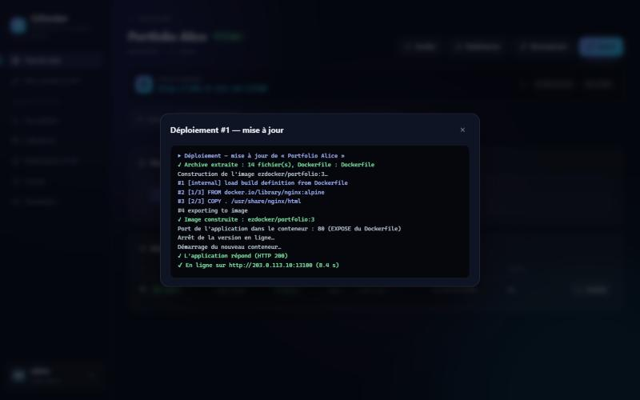
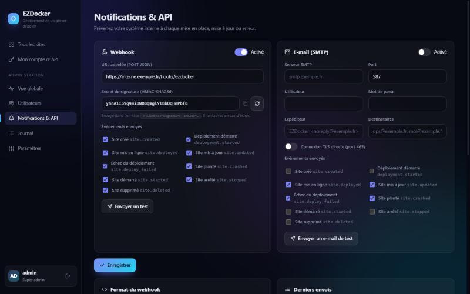

<div align="center">

# 📦 EZDocker

**Déposez un `.zip`, votre site est en ligne.**

Mini-plateforme d'hébergement auto-hébergée : vos utilisateurs glissent une archive contenant un `Dockerfile`,
EZDocker la construit, la lance et l'expose automatiquement sur un port libre. Mise à jour = redéposer le zip.

[](https://github.com/Ezoxe/EZDocker/actions/workflows/ci.yml)




</div>

<table>
  <tr>
    <td></td>
    <td></td>
    <td></td>
  </tr>
  <tr>
    <td align="center"><sub>Statistiques par site</sub></td>
    <td align="center"><sub>Déploiement suivi en direct</sub></td>
    <td align="center"><sub>Webhook & e-mail pour vos systèmes</sub></td>
  </tr>
</table>

---

## ✨ Fonctionnalités

- **Glisser-déposer** d'une archive `.zip` → extraction sécurisée → `docker build` → conteneur en ligne sur `http://IP:port`.
- **Port attribué automatiquement** dans une plage configurable (par défaut `10000-19999`).
- **Mises à jour sans risque** : si la nouvelle version ne démarre pas, l'ancienne est remise en ligne automatiquement.
  Historique des versions et **restauration** en un clic.
- **Suivi en direct** du déploiement : étapes animées et journal de build en streaming.
- **Statistiques d'accès** par site : requêtes, visiteurs uniques, bande passante, temps de réponse, codes HTTP, derniers accès, graphiques 24 h / 14 jours.
- **Infos techniques** : IP du serveur, port public, IP et ID du conteneur, image, CPU / RAM en temps réel, logs de l'application.
- **Comptes** : un **super admin** (vous) crée les comptes utilisateurs et fixe leurs limites (nombre de sites, RAM, CPU).
- **Notifications pour vos systèmes internes** : **webhook** JSON signé HMAC-SHA256, **e-mail SMTP**, et **API REST** (jetons) avec journal d'événements.
- **Installation en une commande** sur Debian : installe Docker, construit et démarre tout.

## 🚀 Installation

Sur une machine **Debian 11 / 12 / 13** (ou Ubuntu) fraîchement installée, en root :

```bash
curl -fsSL https://raw.githubusercontent.com/Ezoxe/EZDocker/main/install.sh | sudo bash
```

Le script :

1. installe les paquets nécessaires et **Docker** (dépôt officiel) s'il est absent ;
2. vous pose 5 questions (port du panel, adresse publique, plage de ports, identifiant et mot de passe du super admin) ;
3. récupère EZDocker dans `/opt/ezdocker`, construit l'image et la démarre ;
4. installe la commande `ezdocker` et ouvre les ports si `ufw` est actif.

À la fin, il affiche l'URL du panel et vos identifiants. 🎉

<details>
<summary><b>Installation non interactive</b></summary>

```bash
curl -fsSL https://raw.githubusercontent.com/Ezoxe/EZDocker/main/install.sh | sudo \
  EZD_NONINTERACTIVE=1 \
  EZD_PORT=80 \
  EZD_PUBLIC_HOST=203.0.113.10 \
  EZD_PORT_RANGE=10000-19999 \
  EZD_ADMIN_USER=admin \
  EZD_ADMIN_PASSWORD='un-mot-de-passe-solide' \
  bash
```

| Variable | Défaut | Rôle |
|---|---|---|
| `EZD_PORT` | `80` (ou `8080` si occupé) | Port du panel |
| `EZD_PUBLIC_HOST` | IP publique détectée | Adresse affichée dans les URL des sites |
| `EZD_PORT_RANGE` | `10000-19999` | Ports attribués aux sites |
| `EZD_ADMIN_USER` / `EZD_ADMIN_PASSWORD` | `admin` / généré | Compte super admin |
| `EZD_DIR` | `/opt/ezdocker` | Dossier d'installation |
| `EZD_BRANCH` | `main` | Branche Git |

</details>

> **Pare-feu** : ouvrez le port du panel et la plage de ports des sites (fait automatiquement avec `ufw`).

## 🧭 Utilisation

1. Connectez-vous au panel avec le compte super admin.
2. **Utilisateurs → Nouvel utilisateur** : un mot de passe temporaire est généré (à changer à la première connexion).
3. L'utilisateur clique sur **Nouveau site**, choisit un nom et dépose son `.zip`.
4. Quelques secondes plus tard, le site est en ligne sur `http://IP:port` 🎉
5. Pour **mettre à jour** : redéposer un `.zip` sur la page du site (ou via l'API).

### Format de l'archive

```
mon-site.zip
├── Dockerfile      ← obligatoire, à la racine (ou dans un unique dossier racine)
├── index.html
└── ...
```

- L'application doit écouter sur le port déclaré par `EXPOSE` (sinon `80`, ou le port défini dans les paramètres du site).
- La variable d'environnement `PORT` est fournie automatiquement au conteneur.
- Un `.dockerignore` est respecté. Les variables d'environnement se règlent dans **Paramètres** du site.
- **Données persistantes** : chaque dossier déclaré par `VOLUME` dans le `Dockerfile` (par exemple `VOLUME ["/data"]`)
  est stocké dans un volume Docker propre au site (`ezd-site-<id>-<chemin>`). Il est remonté à chaque mise à jour
  et à chaque restauration : bases SQLite, fichiers déposés… survivent aux nouveaux zips. Il n'est supprimé
  qu'avec le site.

Un exemple prêt à l'emploi est téléchargeable depuis le panel (**Exemple .zip**) et dans [`examples/hello-site`](examples/hello-site).

<details>
<summary><b>Exemples de Dockerfile</b></summary>

Site statique :

```dockerfile
FROM nginx:alpine
COPY . /usr/share/nginx/html
EXPOSE 80
```

Application Node.js :

```dockerfile
FROM node:24-alpine
WORKDIR /app
COPY package*.json ./
RUN npm ci --omit=dev
COPY . .
EXPOSE 3000
CMD ["node", "server.js"]
```

Application PHP :

```dockerfile
FROM php:8.3-apache
COPY . /var/www/html/
EXPOSE 80
```

</details>

## 🔔 Notifications & API pour vos systèmes internes

### Événements

| Événement | Quand |
|---|---|
| `site.created` | Un site est créé |
| `deployment.started` | Un déploiement démarre |
| `site.deployed` | **Mise en place** : premier déploiement réussi |
| `site.updated` | **Mise à jour** réussie (nouvelle archive, restauration, configuration) |
| `site.deploy_failed` | **Erreur** de déploiement (build ou démarrage) |
| `site.crashed` | Le conteneur s'est arrêté de façon inattendue |
| `site.started` / `site.stopped` | Démarrage / arrêt manuel |
| `site.deleted` | Site supprimé |

### Webhook

Configurable dans **Notifications & API** : URL, secret, événements. Chaque événement est envoyé en `POST` JSON
(3 tentatives) avec les en-têtes `X-EZDocker-Event`, `X-EZDocker-Delivery`, `X-EZDocker-Timestamp` et
`X-EZDocker-Signature: sha256=<HMAC-SHA256(secret, corps)>`.

```json
{
  "id": "evt_42",
  "event": "site.updated",
  "label": "Site mis à jour",
  "message": "Portfolio a été mis à jour (mise à jour)",
  "timestamp": "2026-10-18T10:00:00.000Z",
  "instance": { "name": "EZDocker", "host": "203.0.113.10", "version": "1.0.0" },
  "actor": { "id": 2, "username": "jdupont" },
  "site": {
    "id": 3, "name": "Portfolio", "slug": "portfolio", "owner": "jdupont", "status": "running",
    "host": "203.0.113.10", "port": 10003, "url": "http://203.0.113.10:10003",
    "container_id": "f3a1…", "image": "ezdocker/portfolio:12"
  },
  "deployment": { "id": 12, "kind": "update", "source": "web", "status": "success", "error": null, "duration_ms": 8421 }
}
```

Vérifier la signature (Node.js) :

```js
const expected = 'sha256=' + crypto.createHmac('sha256', SECRET).update(rawBody).digest('hex');
crypto.timingSafeEqual(Buffer.from(expected), Buffer.from(req.headers['x-ezdocker-signature']));
```

### E-mail

Serveur SMTP, destinataires et événements configurables depuis le panel, avec bouton de test.

### API REST

Créez un jeton dans **Mon compte & API**, puis utilisez `Authorization: Bearer ezd_…`.
Un jeton a les droits de son propriétaire (un jeton du super admin voit tout).

```bash
# Déployer / mettre à jour (crée le site s'il n'existe pas avec ?create=1)
curl -H "Authorization: Bearer $TOKEN" -F file=@site.zip "http://PANEL/api/sites/mon-site/deploy?create=1"

# Lister les sites avec IP, port, statut et statistiques
curl -H "Authorization: Bearer $TOKEN" http://PANEL/api/sites

# Récupérer les nouveaux événements (polling)
curl -H "Authorization: Bearer $TOKEN" "http://PANEL/api/events?since=42"
```

| Méthode | Route | Description |
|---|---|---|
| `GET` | `/api/sites` | Sites visibles + stats 24 h |
| `POST` | `/api/sites` | Créer un site `{name, slug?}` |
| `GET` | `/api/sites/:slug` | Détail, conteneur (IP, CPU, RAM…), stats |
| `PATCH` | `/api/sites/:slug` | `{name, env, container_port, memory_mb, cpus}` |
| `DELETE` | `/api/sites/:slug` | Supprimer |
| `POST` | `/api/sites/:slug/deploy` | Déposer un zip (`multipart`, champ `file`) |
| `POST` | `/api/sites/:slug/start` · `stop` · `restart` · `rebuild` | Actions |
| `GET` | `/api/sites/:slug/deployments` | Historique |
| `GET` | `/api/sites/:slug/deployments/:id` | Détail + journal de build |
| `POST` | `/api/sites/:slug/deployments/:id/rollback` | Restaurer une version |
| `GET` | `/api/sites/:slug/logs?tail=300` | Logs de l'application |
| `GET` | `/api/sites/:slug/stats` | Statistiques détaillées |
| `GET` | `/api/events?since=&type=&site_id=` | Journal d'événements |
| `GET` | `/api/health` | Santé (public) |

## 🛠️ Administration du serveur

```bash
ezdocker status                 # état du panel et des sites
ezdocker logs                   # journal du panel
ezdocker update                 # met à jour EZDocker depuis GitHub
ezdocker reset-admin-password   # nouveau mot de passe super admin
ezdocker backup                 # sauvegarde base + configuration
ezdocker restart | stop | start
ezdocker uninstall              # supprime EZDocker et tous les sites
```

La configuration est dans `/opt/ezdocker/.env`, les données dans `/opt/ezdocker/data` (base SQLite, archives).

## 🏗️ Architecture

```
                Internet
                   │
   ┌───────────────┼──────────────────────────────────────────┐
   │  Machine Debian│                                          │
   │               ▼                                          │
   │   ┌──────────────────────────┐   docker.sock   ┌───────┐ │
   │   │ EZDocker (Node.js)       │ ──────────────▶ │Docker │ │
   │   │  • panel + API  :80      │                 └───┬───┘ │
   │   │  • proxy + stats :10001 ─┼──▶ 127.0.0.1:20001 ──▶ conteneur site A
   │   │  • proxy + stats :10002 ─┼──▶ 127.0.0.1:20002 ──▶ conteneur site B
   │   │  • SQLite, webhooks, SMTP│                            │
   │   └──────────────────────────┘                            │
   └───────────────────────────────────────────────────────────┘
```

- Chaque site a un **port public** (plage configurée) sur lequel EZDocker écoute : il compte les accès puis relaie vers le
  conteneur, publié uniquement en local (`port public + 10000`). Les WebSockets sont supportés.
- Les conteneurs tournent sur un réseau Docker dédié **sans communication inter-sites**, avec limites RAM / CPU / processus,
  `no-new-privileges` et redémarrage automatique.
- Les 3 dernières versions de chaque site sont conservées pour la restauration.
- Le cache de build Docker inutilisé depuis 72 h est supprimé après chaque déploiement réussi. Si un build
  échoue faute de place (`no space left on device`), EZDocker vide tout le cache de build et les images
  orphelines, puis relance le build une fois.

## 🔒 Sécurité

- Seul le super admin crée des comptes. Les mots de passe sont hachés (scrypt), les sessions sont en cookie `HttpOnly`,
  les tentatives de connexion sont limitées.
- Les utilisateurs exécutent **leur propre code** dans des conteneurs : ne donnez un compte qu'à des personnes de confiance.
- Pour servir le panel en HTTPS, placez-le derrière un reverse proxy (Caddy, Nginx) et ajoutez `EZD_SECURE_COOKIES=1`
  et `EZD_TRUST_PROXY=1` dans `.env`.

## 👩‍💻 Développement

```bash
npm install
npm run dev      # http://localhost:3000 (Docker local requis pour déployer)
npm test         # tests unitaires et API
```

La CI exécute aussi `install.sh` sur une machine Ubuntu puis un scénario complet (`test/e2e.sh`) : création d'utilisateur,
déploiement, statistiques, mise à jour, conteneur qui plante avec retour à la version précédente, build en erreur,
restauration, webhooks signés, suppression.

## 📄 Licence

[MIT](LICENSE)
